<p align="center">
  <picture>
    <source media="(prefers-color-scheme: dark)" srcset="docs/readme/banner-dark.png">
    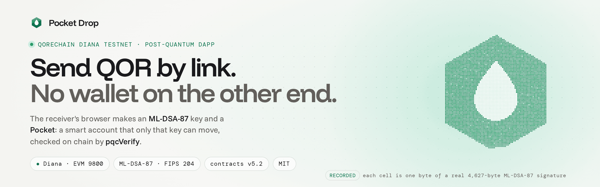
  </picture>
</p>

<p align="center">
  <a href="https://github.com/mohamedwael201193/pocket-drop/actions/workflows/ci.yml"></a>
  <a href="LICENSE"></a>
  <a href="#tests"></a>
  <a href="#verify-it-yourself"></a>
  <a href="#contracts-on-diana-v52"></a>
</p>

<p align="center">
  <a href="https://pocket-drop.vercel.app"><b>Live app</b></a> ·
  <a href="https://pocket-drop.vercel.app/judges">Judges checklist</a> ·
  <a href="https://pocket-drop.vercel.app/qday">Q-Day drill</a> ·
  <a href="https://pocket-drop-api.vercel.app/api/health">API health</a> ·
  <a href="docs/AUDIT.md">Audit</a> ·
  Video: <i>link added at submission</i>
</p>

**Send QOR to someone who has no wallet.** You share a link. Their browser makes an ML-DSA-87 (FIPS 204) key and a **Pocket**: a smart account that only that key can move.

**A leaked classical key cannot move the money.** Every spend needs a post-quantum signature, and the chain checks it through its `pqcVerify` (0x0A01) and `pqcKeyStatus` (0x0A02) precompiles. No server does that check.

**Everything below is on the QoreChain Diana testnet** (EVM chain id 9800, Cosmos chain id `qorechain-diana`). The QOR there has no monetary value. Track: Post-Quantum dApp.

## Try it in 60 seconds

| | Open | What you should see |
|---|---|---|
| 1 | [`/qday`](https://pocket-drop.vercel.app/qday) | Five bait Pockets whose **classical private keys are published on the page**. Their balances are LIVE. Our own attacker bot tries to take the QOR every hour, and every attempt is refused. Copy a key and try it yourself. |
| 2 | [`/receive`](https://pocket-drop.vercel.app/receive) → **Open the sample pool** | Take one slot of a team-hosted pool. Your browser creates a key and a Pocket, and the QOR lands in it. No wallet needed. |
| 3 | The transaction link shown after the claim, which opens [`/check`](https://pocket-drop.vercel.app/check) | The claim on Diana, mined through the router. `/check` re-runs each ML-DSA-87 signature check in your browser, using the public keys the chain holds. |
| 4 | [`/judges`](https://pocket-drop.vercel.app/judges) | Every track requirement, mapped to code, a live transaction and a test. |

> [!NOTE]
> Each number in this README carries a label. **LIVE** is read from the chain or the API when you open the link. **RECORDED** comes from a file in this repo, written by a named script on the date shown. **TEAM-RUN** means team test accounts did it; they are never counted as external users. **ILLUSTRATION** marks a picture that is not data.

## Screens

All screenshots are of the live app, taken on 26 Nov 2026 from a fresh browser with no key (how: [docs/readme/ASSETS.md](docs/readme/ASSETS.md)).

<table>
  <tr>
    <td width="50%">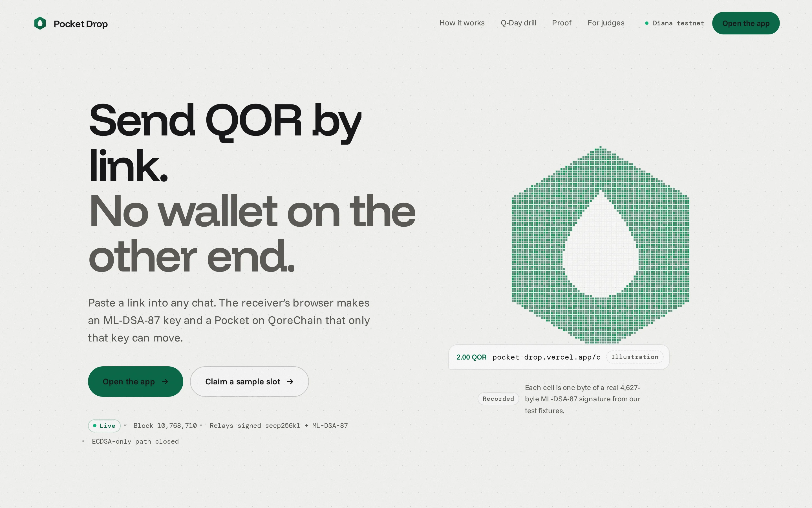<br><sub><b>Landing.</b> The hexagon is drawn from the bytes of a real 4,627-byte ML-DSA-87 signature (RECORDED).</sub></td>
    <td width="50%">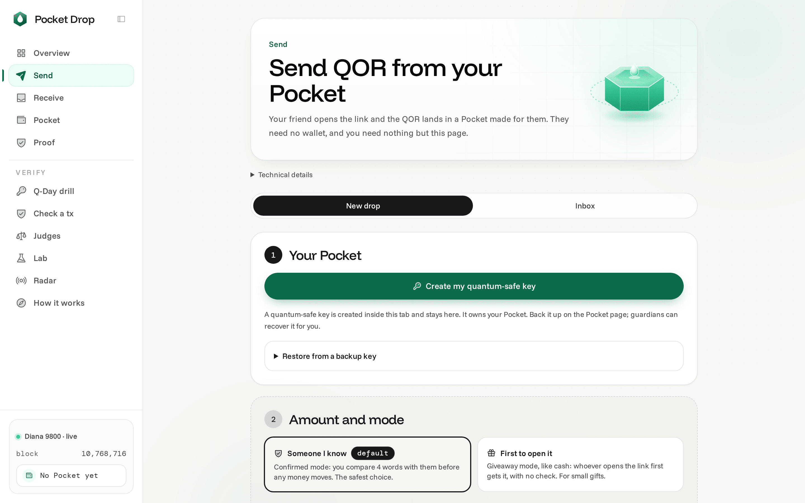<br><sub><b>Send.</b> Your key is made in this tab. "Someone I know" (Confirmed) is the default.</sub></td>
  </tr>
  <tr>
    <td>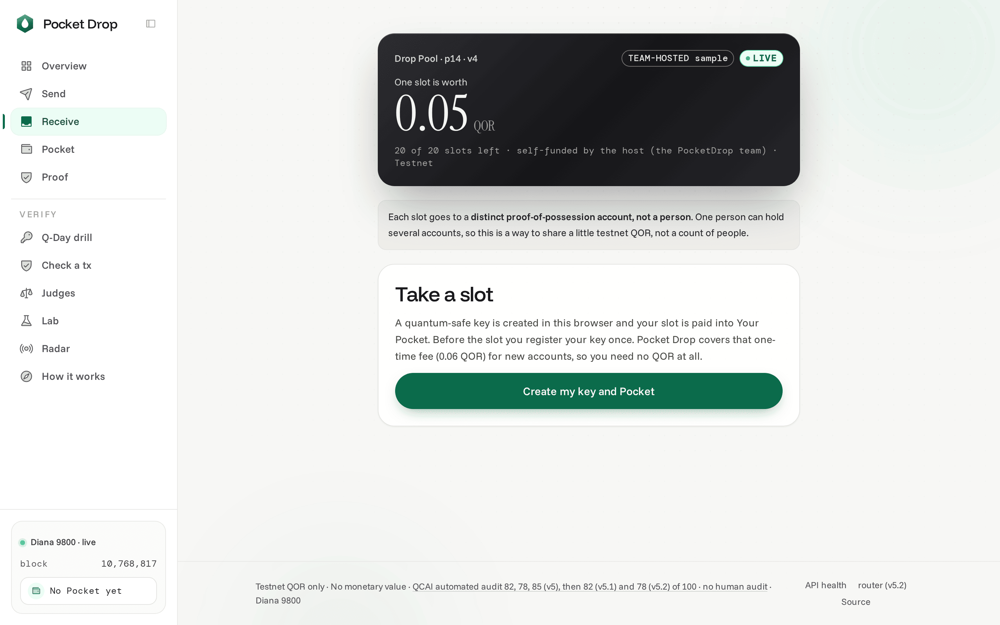<br><sub><b>Receive: the claim screen.</b> The team-hosted sample pool, before a slot is taken. Slots left are LIVE.</sub></td>
    <td>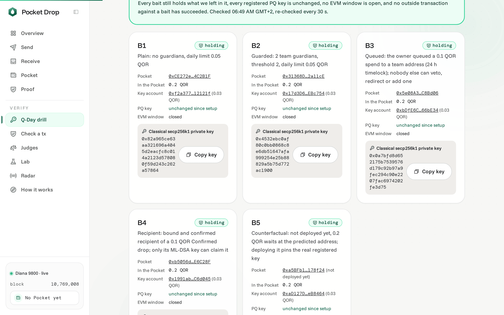<br><sub><b>Q-Day drill.</b> Five Pockets, classical keys published, still holding.</sub></td>
  </tr>
  <tr>
    <td>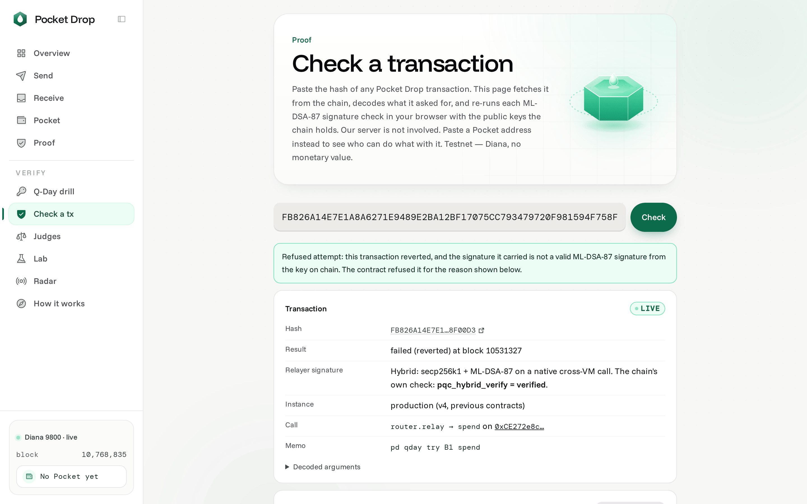<br><sub><b>Check a transaction.</b> A refused Q-Day attack, decoded and re-verified in the browser.</sub></td>
    <td>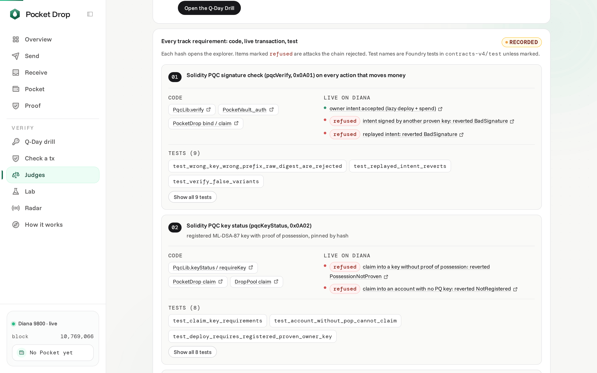<br><sub><b>Judges.</b> Each requirement: code, live transactions (refused attacks marked) and tests.</sub></td>
  </tr>
</table>

<table>
  <tr>
    <td width="25%">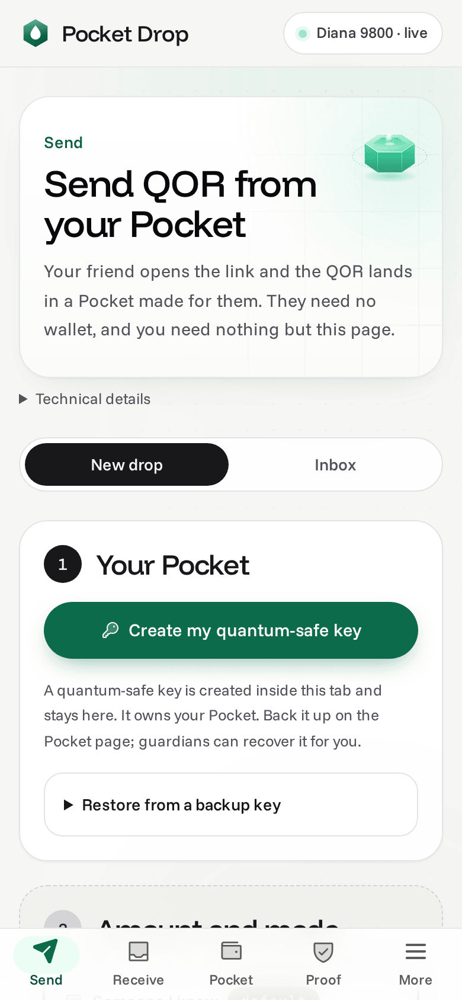<br><sub>Send (390×844)</sub></td>
    <td width="25%">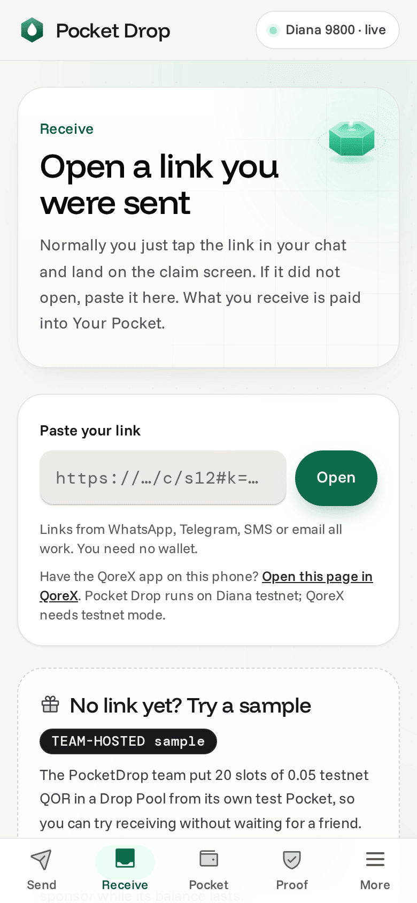<br><sub>Receive</sub></td>
    <td width="25%">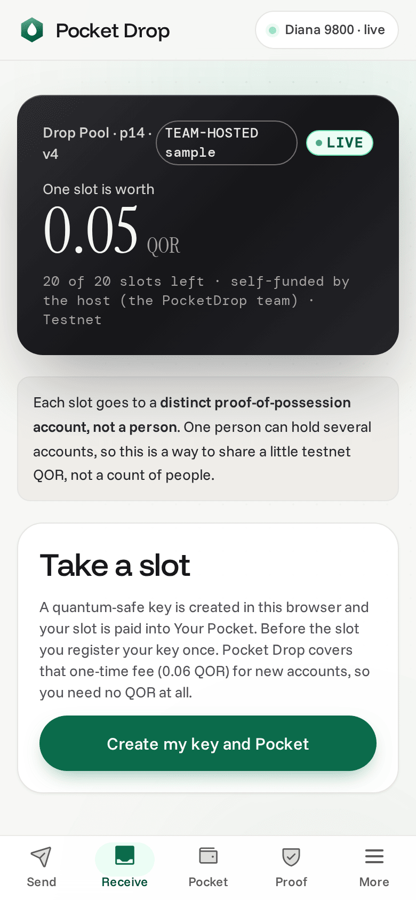<br><sub>Claim screen</sub></td>
    <td width="25%">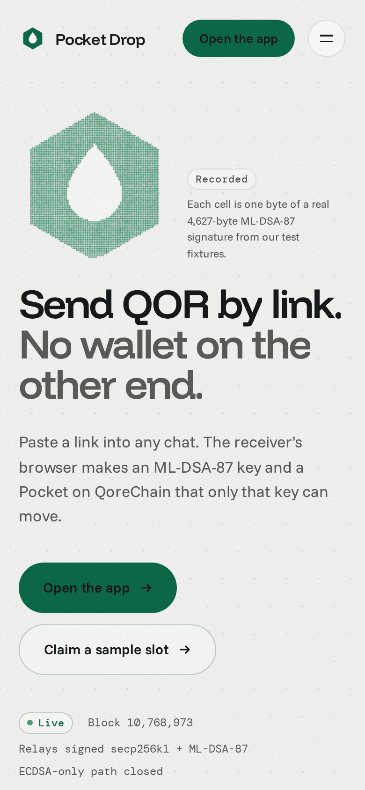<br><sub>Landing</sub></td>
  </tr>
</table>

<details>
<summary><b>A full send and claim on v5.2, in the app</b> (RECORDED, TEAM-RUN, 26 Nov 2026, Playwright on a 390-pixel phone viewport)</summary>
<br>

The Playwright run behind [`chromium-390-a-confirmed.json`](frontend/evidence/v4/e2e/chromium-390-a-confirmed.json) sent link `s7` (0.1 QOR, Confirmed mode) between two team test accounts and took these screenshots. Every step is a transaction on Diana; see row 9 of the [proof table](#proof-every-claim-with-its-transaction).

<table>
  <tr>
    <td width="25%">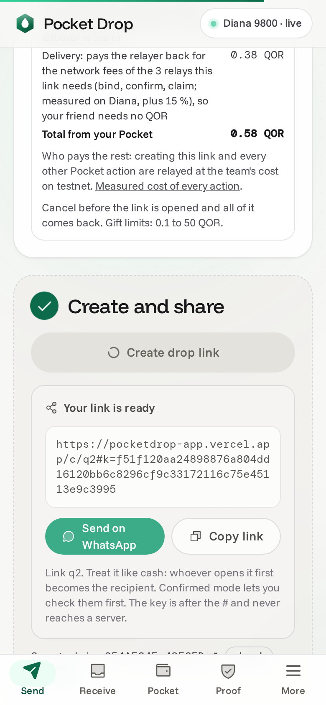<br><sub>1. Sender: the link is ready to share</sub></td>
    <td width="25%">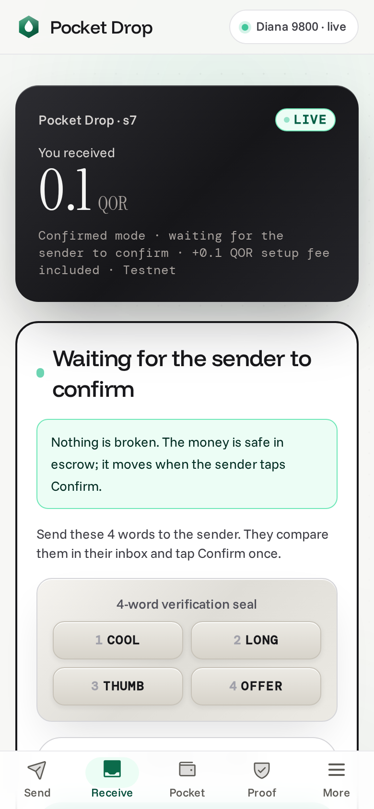<br><sub>2. Recipient: 4 words to read to the sender</sub></td>
    <td width="25%">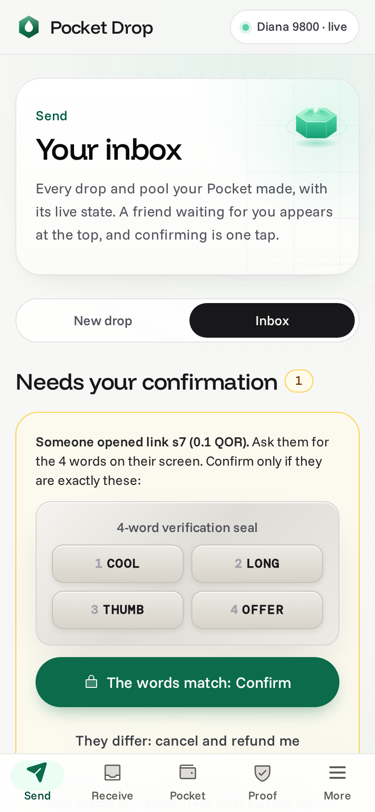<br><sub>3. Sender: the words match, one tap</sub></td>
    <td width="25%">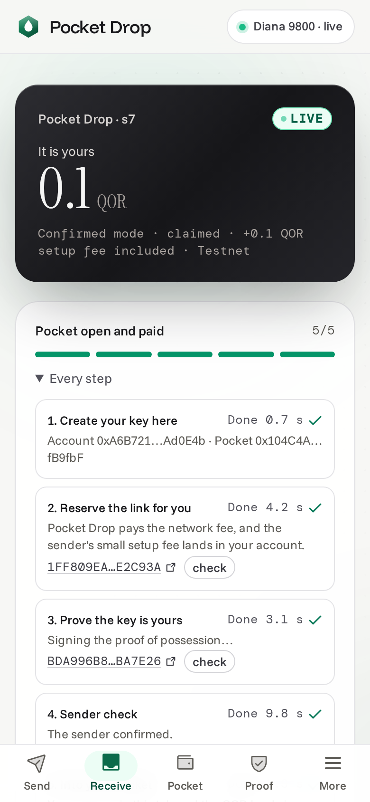<br><sub>4. Recipient: paid, each step with its tx</sub></td>
  </tr>
</table>

More screens: [Pocket](docs/readme/screens/pocket.png) · [Proof](docs/readme/screens/proof.png) · [Judges](docs/readme/screens/judges.png) · [Measured delta on /judges](docs/readme/screens/judges-delta.png) · [Refused attempts](docs/readme/screens/qday-refused.png) · [Radar](docs/readme/screens/radar.png) · [Overview](docs/readme/screens/app.png) · [Receive](docs/readme/screens/receive.png) · guardian freeze run: [1](frontend/evidence/v4/e2e/chromium-390-d-freeze-lab-1-owner-guardians.png), [2](frontend/evidence/v4/e2e/chromium-390-d-freeze-lab-2-guardian-submit.png), [3](frontend/evidence/v4/e2e/chromium-390-d-freeze-lab-3-owner-frozen.png).

</details>

## The story

**The problem.** Almost every account on every chain today is a secp256k1 key. On Q-Day, a quantum computer can compute that private key from public data, and whoever holds the key can sign as the owner. That does not need a quantum computer to happen once: a leaked seed phrase or a phished key has the same effect today. Money that sits behind one classical key is only as safe as that key.

**The second problem.** Sending money to someone new means they first need a wallet, a seed phrase, and some gas. Most people stop there.

**What a Pocket is.** A Pocket is a smart account (`PocketVault`) whose owner is an ML-DSA-87 key, registered on chain with proof of possession; the key's hash is pinned when the Pocket is created. Every owner action is an intent signed with that key, and the contract checks it with `pqcVerify`. The classical key only pays gas. A Pocket also has a daily spending limit with a timelock above it, guardians who can freeze it, and recovery to a new key.

**What Pocket Drop does.** A sender funds a one-time link. The person who opens it gets a key and a Pocket in their browser, binds the link to that key on chain, and claims into their Pocket. The link's drip pays for their key registration, and the relayer pays EVM gas, so they need no QOR to start. In Confirmed mode, the default, the sender checks 4 words of the recipient's key before any money moves.

**How we show it holds.** We published the classical keys of five bait Pockets on [`/qday`](https://pocket-drop.vercel.app/qday) and attack them every hour. The money is still there.

## How it works

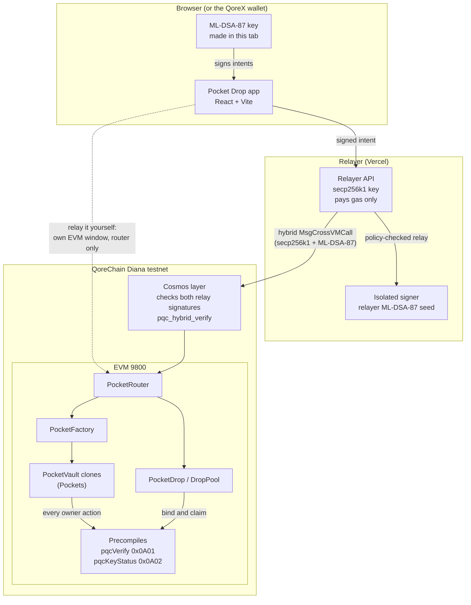

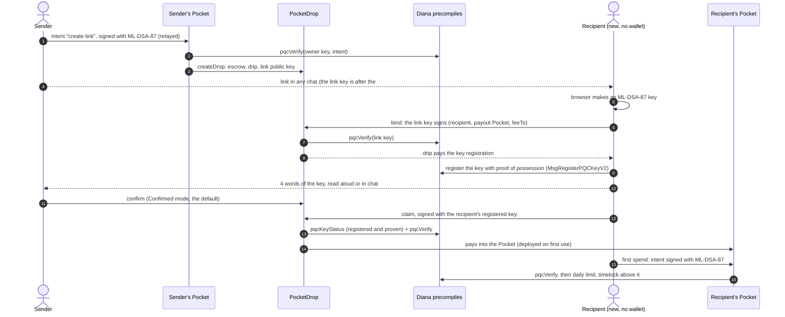

<details>
<summary><b>The parts, in more detail</b></summary>
<br>

- **Pocket** (`PocketVault`, cloned by `PocketFactory`). The owner is an address whose ML-DSA-87 key is registered with proof of possession; the key's hash is pinned at creation. Every owner action is an intent signed with that key over a QoreX-format message (`qorechain-msg-v1|qorechain-diana|0x<digest>`) that binds the chain, the Pocket, the action, the nonce and the deadline.
  - Spends are free up to a daily limit. Anything above it is queued behind a timelock and can be vetoed by the owner.
  - Guardians (up to 5) can freeze the Pocket, recover it by threshold (the owner can veto), or recover it unanimously (the old key cannot veto). On v5.2, finishing a recovery needs an ML-DSA-87 authorization from the owner, a guardian or the approved new owner, and never the old owner on the unanimous path.
  - ERC-1271 `isValidSignature` exposes the same check to other contracts. `PqGuard` lets any dApp require a post-quantum approval (example: `PqGuardedCounter`).
- **PocketRouter** relays signed intents and can deploy a Pocket on first use. Funds sent to a Pocket's address before it exists are kept.
- **PocketDrop** (send by link) and **DropPool** (one link, many claimers). The link key binds one recipient (`pqcVerify`). The claim needs the recipient's registered, proven key (`pqcKeyStatus`) and a signature from it (`pqcVerify`).
- **Relayer** (`backend/`, Vercel functions) pays gas and forwards intents as hybrid-signed `MsgCrossVMCall`s (secp256k1 + ML-DSA-87, both checked by the chain before the EVM runs). It cannot forge any intent. Its ML-DSA-87 half is signed by a separate deployment (`signer/`) that signs only policy-checked relays.
- **Confirmed by default.** A new link is Confirmed (Someone I know): the sender compares 4 words of the recipient's key before any money moves. Open (first to open it) is for small gifts and works like cash; above 0.5 QOR the app asks for an explicit OK before it makes one.
- **Relay it yourself.** `PocketRouter.relay` has no caller check, so the relayer is optional. When it is down or slow (or always, with the Advanced setting on `/pocket`), the user's own account opens a hybrid-signed EVM window scoped to the one router (about 9 minutes, 3 transactions) and submits the call it signed. Inside that window the classical key can only call the router, and the router only forwards calls whose authority is an ML-DSA-87 signature. The account pays its own fees (a link's drip covers it). The native window transaction goes through the app's key-less `/rpc` proxy because Diana's public REST and RPC send no CORS headers. Code: [`frontend/src/lib/selfRelay.ts`](frontend/src/lib/selfRelay.ts).
- **Open in QoreX.** The claim and receive pages link to the same page in the QoreX app's dApp browser, using the `browse` link from the [QoreX dApp integration guide](https://docs.qorechain.io/qorex/dapp-integration). A claim link carries its link key in the `#` fragment, so it only gets the on-device `qorex://browse` form, never the `https://link.qore.network/browse` form, which would send the key to a web server. The QoreX hand-off has not yet been tried on a real phone.

Every `pqcVerify` and `pqcKeyStatus` call site, what it protects and its tests: [docs/AUDIT.md, section 5](docs/AUDIT.md#5-post-quantum-design-every-pqcverify-and-pqckeystatus-call-site).

</details>

<details>
<summary><b>How Pocket Drop differs from a payment request or a bearer claim link</b></summary>
<br>

- **From a wallet-to-wallet payment request.** A payment request is signed by someone who already has a wallet and asks another wallet holder to pay. Pocket Drop goes the other way: the sender pushes money to someone who has no wallet, no key and no QOR yet. Opening the link creates their key and their Pocket, and the link's drip pays for the key registration.
- **From a bearer claim link.** Whoever holds a bearer link can take the money. A Pocket Drop link binds exactly one recipient key on chain. In Confirmed mode, the default, the money moves only after the sender has checked 4 words of that key, so someone who intercepts the link can bind it but cannot claim it (row 1 below). Open mode is the bearer case, and the app says so.
- **Where the money lands.** It lands in a Pocket, a smart account that only an ML-DSA-87 key can move, with a daily limit, a timelock above it, guardians and recovery, all enforced by the contract rather than by an app.

</details>

## Contracts on Diana (v5.2)

The current system is v5.2 production, deployed 26 Nov 2026 (RECORDED in [`contracts-v4/deployments/diana.json`](contracts-v4/deployments/diana.json) under `v5_2`; code and wiring re-checked LIVE by `node frontend/scripts/reverify.mjs`). The app and the API use only these for new Pockets, drops and pools. The contracts are frozen: no owner, admin, pause or upgrade.

The address links open `explore.qore.network`, which starts on Mainnet: pick **Testnet** in its header to see the Diana account.

| Contract | Address | Role |
|---|---|---|
| PocketRouter | [`0xe0a2679ae760a843880489c8cf8da15c00559a88`](https://explore.qore.network/address/0xe0a2679ae760a843880489c8cf8da15c00559a88) | relays every signed intent; deploys a Pocket on first use |
| PocketFactory | [`0x8aa57c26fb2ce4389c7732ab7876265dbb9e5278`](https://explore.qore.network/address/0x8aa57c26fb2ce4389c7732ab7876265dbb9e5278) | creates Pockets (clones of the vault) |
| PocketVault (implementation) | [`0x02375366fc06356e0020c93fbe9d5d8fcbeb4f16`](https://explore.qore.network/address/0x02375366fc06356e0020c93fbe9d5d8fcbeb4f16) | the Pocket logic every clone runs |
| PocketDrop | [`0xf0103854937897d6d117f947046d53fbc66a2639`](https://explore.qore.network/address/0xf0103854937897d6d117f947046d53fbc66a2639) | send by link |
| DropPool | [`0xab3ac2fedb07c1e419ea86f41d49d417dd10dbf9`](https://explore.qore.network/address/0xab3ac2fedb07c1e419ea86f41d49d417dd10dbf9) | one link, many claimers |
| PqGuardedCounter | [`0xa320b876afea6e2c1e20da5f7fd195b9db47d0be`](https://explore.qore.network/address/0xa320b876afea6e2c1e20da5f7fd195b9db47d0be) | example dApp that requires a post-quantum approval (PqGuard) |

<details>
<summary><b>Lab instance, earlier generations, relayer, and what holds on an older Pocket</b></summary>
<br>

v5.2 is v5.1 with the guarantees behind the Stage 4 review items made explicit: finalizing a recovery needs an ML-DSA-87 authorization signed by the owner, a guardian or the approved new owner (never the old owner on the unanimous path), the vault has its own reentrancy lock, payouts assert the lock, drip bounds and zero addresses are checked explicitly, and every external function has NatSpec. See [docs/V5_2.md](docs/V5_2.md).

| Contract | v5.2 PROD | v5.2 LAB (60 s delays, for demos) |
|---|---|---|
| PocketRouter | `0xe0a2679ae760a843880489c8cf8da15c00559a88` | `0xa52d5c5eeb65e564f5a76cc6cc8f518c735c7bee` |
| PocketFactory | `0x8aa57c26fb2ce4389c7732ab7876265dbb9e5278` | `0x40e163c011197ea2de23bcbffc64e7150a8e2a20` |
| PocketVault (implementation) | `0x02375366fc06356e0020c93fbe9d5d8fcbeb4f16` | `0x5ca64d1ace94fc727856bf1adb1c48963a23a5d0` |
| PocketDrop | `0xf0103854937897d6d117f947046d53fbc66a2639` | `0x87560569b9dd7aaa294d52f0f3fee0a1d5d88db6` |
| DropPool | `0xab3ac2fedb07c1e419ea86f41d49d417dd10dbf9` | `0xaf0b4976796085f420dc51481a58e2658298792c` |

**Earlier generations: v5.1, v5, v4.** Their addresses, deploy notes and PqGuard examples are in [docs/DEPLOYMENTS.md](docs/DEPLOYMENTS.md) ([v5.1](docs/DEPLOYMENTS.md#v51), [v5](docs/DEPLOYMENTS.md#v5), [v4](docs/DEPLOYMENTS.md#v4), [legacy v3](docs/DEPLOYMENTS.md#legacy-v3)). The contracts cannot be upgraded, so a Pocket keeps the rules of the generation it was made on.

What holds on a Pocket made on an older generation (from `src/` of each generation, [docs/V5_2.md](docs/V5_2.md), [docs/V5_1.md](docs/V5_1.md), [docs/V5.md](docs/V5.md)):

| Guarantee | v4 | v5 | v5.1 | v5.2 (current) |
|---|---|---|---|---|
| Every spend and owner action needs an ML-DSA-87 signature checked by `pqcVerify`; the key's hash is pinned at creation | yes | yes | yes | yes |
| Daily limit, timelock and veto above it, guardian freeze and recovery | yes | yes | yes | yes |
| Exact ML-DSA-87 key and signature sizes checked before the precompile call; exact key-status layout | no (sizes not checked exactly) | yes | yes | yes |
| The bind signs `feeTo`, so a copied bind cannot take the delivery fee | no | no | yes | yes |
| ERC-1271 and PqGuard approvals carry their own tag and are bound to one account and chain | no | no | yes | yes |
| Finalizing a recovery needs a signed authorization (owner, guardian or approved new owner; never the old owner on the unanimous path) | no: anyone may submit it after the delay, to the guardian-approved target only | no (same) | no (same) | yes |
| Pocket has its own reentrancy lock; payouts revert outside the lock | no: drop and pool are locked, the vault relies on checks-effects-interactions | no (same) | no (same) | yes |

The five Q-Day bait Pockets on `/qday` are v4 Pockets on purpose: they show that the oldest generation already refuses a classical-key spend.

**Moving to v5.2.** A v5.1 Pocket can be moved now: when this browser's key has a v5.1 Pocket with a balance, `/pocket` shows "You have QOR on the previous contracts" and moves it to the v5.2 Pocket with one ML-DSA-87-signed spend, up to today's allowance (`frontend/src/components/previousPocket.tsx`, test `frontend/test/v5-migration.test.ts`). The app does not offer this for v5 or v4 Pockets. Those funds stay safe and spendable on their own contracts, but there is no one-tap move. We did not add one for this build: a move through the v5 and v4 routers from this app has not been exercised live, and we do not ship an untested button that moves funds.

- Legacy v3 PocketDrop (still readable, used by old links): `0x29f53b4b8031e7ba1785dc8c7a1c0be413a4bd97`
- Relayer: `0xF6e6fb2d33Bef3043682658E2b69F3a2F8616cCD` / `qor17mn0ktfnhmesgd5zvk8zk60n5tuxzmxdc8ymnl`
- Explorer: `https://pocket-drop.vercel.app/check/<hash>`

</details>

## Proof: every claim with its transaction

Rows 1 to 8 are the parts specific to this design: a link bound to one key, post-quantum authorized recovery, relaying without our server, and published classical keys. Rows 9 to 16 are the basic flows and refusals. Every hash below was re-read from Diana on 26 Nov 2026 (EVM receipts from `https://evm-testnet.qore.host`, Cosmos transactions from `https://api-testnet.qore.host`); every expected revert was replayed with `eth_call` and the custom error decoded. Hashes starting `0x` are EVM transactions; the others are Cosmos transactions, mostly hybrid-signed `MsgCrossVMCall` relays. Each router call opens on [`/check`](https://pocket-drop.vercel.app/check), which reads the transaction from the chain, decodes the call and re-runs each ML-DSA-87 check in your browser. The six plain Cosmos transactions (a bank transfer, key registrations, opening and closing an EVM window) are not router calls, so they link to the chain's REST record instead. (The public explorer at `explore.qore.network` opens on Mainnet and does not resolve EVM `0x` hashes; to look up a Cosmos hash there, pick **Testnet** in its header first.) All accounts are TEAM-RUN test accounts. Gen = the contract generation the transaction ran on.

| # | Claim | Transactions on Diana | Result | Gen | Test |
|---|---|---|---|---|---|
| 1 | **Someone who intercepts a Confirmed link cannot take the money.** | create [`0x7ccd72da…`](https://pocket-drop.vercel.app/check/0x7ccd72da14ca3d974ae26b86b624823402c729b15548e5f05926923102a38e15) · interceptor binds its own key [`0x344f3f7e…`](https://pocket-drop.vercel.app/check/0x344f3f7e1ec5c78e120dd0e1ac60a9392a9423ca774b45b8bfd5c7e91c7a14be) · its claim [`0x2cfa0b93…`](https://pocket-drop.vercel.app/check/0x2cfa0b93ffbf082f4318c19a108e8a003cf329f33db4ef7002686c6880d6a235) · sender sees unknown words and cancels [`0xe643d8a5…`](https://pocket-drop.vercel.app/check/0xe643d8a584de98b670cce862153ed217d8fef8b26983d3393f3e9aa272b85410) · claim again [`0x4831b588…`](https://pocket-drop.vercel.app/check/0x4831b588679a73069059f1eb02dd2ba6e08a7d459d5a4403a32a89bf8cccb60c) | both claims reverted `InvalidState` (Bound, then Cancelled); the escrow went back to the sender | v5.2 | `test_confirmed_mode_cannot_claim_before_confirm` |
| 2 | **A copied bind cannot redirect the delivery fee.** | the signed bind resubmitted with `feeTo` changed [`0xf32d8ba7…`](https://pocket-drop.vercel.app/check/0xf32d8ba7bbbd0615f29a834a813717abadca7d591ecdbc3ce451bb8fa6535c57) | reverted `BadLinkSignature`, nothing paid | v5.2 | `test_v51_F1_frontrunner_cannot_take_the_relayer_fee` |
| 3 | **A recovery cannot be finished early, by an outsider, with a forged signature, or by the old owner.** | guardians propose [`0x7e6db471…`](https://pocket-drop.vercel.app/check/0x7e6db471fbd00387f0f95f1bffd219e0d212191382f94f01f1780c77bba60d43) · too early [`0x679e36b3…`](https://pocket-drop.vercel.app/check/0x679e36b3cb1990dfa503b1545f51fcb67b3ed5e5b88ad83dbde5458c6ae7974f) · outsider [`0xe44212b3…`](https://pocket-drop.vercel.app/check/0xe44212b3c8b5358323702b8b1a883227be5b365191ed091317b5c8dfa7e4cc93) · forged [`0x743e98ad…`](https://pocket-drop.vercel.app/check/0x743e98ad0171a74c9f896f1c2602259d55218d595c07b17ae4dd4544085a370e) · new owner finishes [`0x6c1e0a00…`](https://pocket-drop.vercel.app/check/0x6c1e0a0039e96b0911b8d884cb2c452297cfa0a00cf7287373802e571b1ec2a7) · unanimous proposal [`0xdfe5da62…`](https://pocket-drop.vercel.app/check/0xdfe5da6260c277e3a29d8d70fa4caa3531cc53f78a4b6756e7c590bd2b03fc2f) · old owner [`0x8eeb97cd…`](https://pocket-drop.vercel.app/check/0x8eeb97cd6d3a572f0b0508fb63c6d4fd72ae068b9243f5f2b77682b91ab26c72) · guardian finishes [`0x186e007b…`](https://pocket-drop.vercel.app/check/0x186e007b9fd53b434752910af85478e8a1bf83adf072591af43ea20838fdc46c) | refused with `TooEarly`, `NotAuthorized`, `BadSignature`, `NotAuthorized`; the new owner and a guardian finished it | v5.2 (lab) | `test_qcai52_f2_*` |
| 4 | **The relayer is optional: a user's own scoped EVM window can claim and spend.** | window to the router only [`858D6C83…`](https://api-testnet.qore.host/cosmos/tx/v1beta1/txs/858D6C836B683DF28DCA3694481888C2B9FD432BC1A8B8FB62301437D889C395) · own claim [`0xeb1c8529…`](https://pocket-drop.vercel.app/check/0xeb1c8529d6b8bd21a757a1a42b43ee692f17c14d2c7a84040ebac0d495e90190) · own first spend [`0xabcb6e92…`](https://pocket-drop.vercel.app/check/0xabcb6e924d5eebe5f7f38aa3e39cfbc23e40fb4b0e1c05f8d094d3cf806606c4) · window closed [`EF7A97BC…`](https://api-testnet.qore.host/cosmos/tx/v1beta1/txs/EF7A97BCB4D48FFDDEC5A0A4DF3F41372318063DA505584FC6AE134107DA6168) | all succeeded; no Pocket Drop server involved ([evidence](frontend/evidence/v4/e2e/self-relay-v52.json)) | v5.2 | `frontend/test/selfRelay.test.ts` |
| 5 | **Every relay carries a post-quantum signature that the chain checks.** | API relay of a lazy deploy + spend [`05EC11A2…`](https://pocket-drop.vercel.app/check/05EC11A2E777AA25D5AB156A467C1FEA288BFBDD3641612702DCF4AAABCE1379) ([check](https://pocket-drop.vercel.app/check/05EC11A2E777AA25D5AB156A467C1FEA288BFBDD3641612702DCF4AAABCE1379)) | `MsgCrossVMCall`, code 0, `pqc_hybrid_verify` verified; LIVE: [`/api/health`](https://pocket-drop-api.vercel.app/api/health) shows `relay.mode: hybrid`, `classicalPathOpen: false` | v5.2 | `backend/test/hybrid.test.ts` |
| 6 | **A published classical key cannot move a Pocket.** | attacker bot's spend on bait B1 [`FB826A14…`](https://pocket-drop.vercel.app/check/FB826A14E7E1A8A6271E9489E2BA12BF17075CC793479720F981594F758F00D3) ([check](https://pocket-drop.vercel.app/check/FB826A14E7E1A8A6271E9489E2BA12BF17075CC793479720F981594F758F00D3)) | refused (code 14, EVM revert); LIVE: [`/qday`](https://pocket-drop.vercel.app/qday) lists every refused attempt and the balances | v4 (on purpose) | `reverify.mjs` section 6 |
| 7 | **Guardians can freeze a Pocket whose key was stolen, and the thief's spend fails.** | freeze [`0xa0042ee4…`](https://pocket-drop.vercel.app/check/0xa0042ee4b44a67f65342c8f99aa117229af5d24ca38301dd03b32261b49956cf) · thief's spend [`0xd4ca2455…`](https://pocket-drop.vercel.app/check/0xd4ca2455271a6a0a2f16862632dda34da026789985089753ecab209fdd86f416) · on v5.2 lab, from the app: 2 of 3 guardians freeze [`C86E7C5B…`](https://pocket-drop.vercel.app/check/C86E7C5BC739DBEE0193609ED56334E314A7511C272F3A0ABE4C9B23C1EAAA8C) | freeze succeeded; the spend reverted `Frozen` | v4, v5.2 | `test_stolen_key_scenario_end_to_end` |
| 8 | **A link gets a new account to its first post-quantum spend; a direct transfer does not.** | path A, first account: claim [`8A734F26…`](https://pocket-drop.vercel.app/check/8A734F26BD4EAC2CDE6FF79C4508F15FD682FB460AF301C64C67DAED05AD6BA9), first spend [`E8B929D0…`](https://pocket-drop.vercel.app/check/E8B929D0C565AF970EAD9E3EB97DDE583BA8EA39B056D6788003EB5C4F2138F9) · path B, first account: direct transfer [`06D1D079…`](https://api-testnet.qore.host/cosmos/tx/v1beta1/txs/06D1D079323B6C42A59E770A9CAF45A92752F3D6F793E4EC6E70B25941590880) | 5 of 5 link accounts spent (median 17 s); 0 of 5 direct-transfer accounts could (refused before broadcast: no registered post-quantum key, classical fallback off). All 10 rows: [docs/DELTA_RUN.md](docs/DELTA_RUN.md) | v5 | `node scripts/delta-verify.mjs` |
| 9 | **The full send and claim works in the app.** | create [`9B1FC3F6…`](https://pocket-drop.vercel.app/check/9B1FC3F69B392D5609F9E035028A49DCDB82590C18AED68086D83A48AEB6616D) · bind [`1FF809EA…`](https://pocket-drop.vercel.app/check/1FF809EA05C6E1B8348B88AD4B52668056818640111A493EE3137D27BBE2C93A) · key registration [`BDA996B8…`](https://api-testnet.qore.host/cosmos/tx/v1beta1/txs/BDA996B859FC2DB6316AA18CB61B90BD58413B655265509FBB5F5752F8BA7E26) · confirm [`E1A4ED9B…`](https://pocket-drop.vercel.app/check/E1A4ED9B80640E19A36DADF6DEEF93F8A3BCFEB3D383AAE3F87ED544E0654C30) · claim [`C2C4D1B9…`](https://pocket-drop.vercel.app/check/C2C4D1B9CC05D969E3AB3AAC77FA807FE97FD2827753F4189BE23E3EDF194124) | all succeeded; link `s7` Claimed, 0.1 QOR in the recipient's Pocket ([evidence](frontend/evidence/v4/e2e/chromium-390-a-confirmed.json), screenshots above) | v5.2 | `frontend/e2e/recipient.spec.ts` |
| 10 | **Send and claim from a script, with the recipient's own key.** | deploy a Pocket + create a link [`0x94ffb825…`](https://pocket-drop.vercel.app/check/0x94ffb825b164747f4c8f7e055b167d5d25bb9da87f238b19a7ae652adab85878) · bind [`0xbb47f306…`](https://pocket-drop.vercel.app/check/0xbb47f306576e12c1d5d60d7a5cc2a8440b7f9151f66b96a799d056f82e209333) · key registration [`7221227E…`](https://api-testnet.qore.host/cosmos/tx/v1beta1/txs/7221227E920C982CA3828C388BE036369FA3BF01822EDA432023D8498B1EA75F) · claim [`0x689a5e37…`](https://pocket-drop.vercel.app/check/0x689a5e37c5121650d517a99f1e9376139675a690b6ca311ca4d36648328acff4) | all succeeded | v5.2 | `node contracts-v4/script/smoke-v52.mjs` |
| 11 | **One link, many claimers.** | host a pool [`0xa6c056ac…`](https://pocket-drop.vercel.app/check/0xa6c056acce11f4f198762033d40d7b9bab4a62f69f64c1cfc082cd468e43d1b0) · take a slot [`0x6bbe38fb…`](https://pocket-drop.vercel.app/check/0x6bbe38fbec3afbb52f74a88afffbf97ce4075fdb596a49d4ceacc71bcd1e052c) · close and refund [`0x2c73c3cf…`](https://pocket-drop.vercel.app/check/0x2c73c3cfee7202ec0ac60daf4857deb1df29b23ce9aee7f8baefc4143a520cad) | all succeeded | v5.2 | `test_pool_*` |
| 12 | **A wrong post-quantum key cannot spend a Pocket.** | [`0x312c0fe1…`](https://pocket-drop.vercel.app/check/0x312c0fe1ecfe1a0159618152ade48639139671adbda5336b4132d06f2a830dcb) | reverted `BadSignature` | v4 | `test_wrong_key_wrong_prefix_raw_digest_are_rejected` |
| 13 | **A replayed intent fails.** | [`0x54d99c1e…`](https://pocket-drop.vercel.app/check/0x54d99c1e8b04744df5a0360a5dd7b0a02b3066d7f39794a5af97f90ba6957fec) | reverted `BadSignature` (the nonce moved, so the signature no longer matches) | v4 | `test_replayed_intent_reverts` |
| 14 | **A claim needs a registered key with proof of possession.** | [`0x4664a69a…`](https://pocket-drop.vercel.app/check/0x4664a69a207575641d38bcf3af724d9f81753c275dd8312c2a66fb3b18be5b5b) | reverted `PossessionNotProven` | v4 | `test_claim_key_requirements` |
| 15 | **A mempool thief cannot swap the recipient.** | [`0xf72a9a09…`](https://pocket-drop.vercel.app/check/0xf72a9a098d5ea3708302968a6caa712b04e3982870d2c7e34e37c28381996318) | reverted `BadLinkSignature` | v4 | `test_bind_rejects` |
| 16 | **A QoreX wallet signature can spend a Pocket.** | [`0xf98daf5e…`](https://pocket-drop.vercel.app/check/0xf98daf5ec7aecb3b82666c25ce10704f251e54460e066a6bc3733a6635286d1a) | succeeded ([evidence](frontend/evidence/v4/e2e/qorex-wallet-intent-2026-11-20.json)) | v4 | `frontend/test/qorex.test.ts` |

<details>
<summary><b>Older rows (v5, v5.1) and where every other hash lives</b></summary>
<br>

| Claim | Transactions | Result | Gen |
|---|---|---|---|
| Interceptor on a Confirmed link, run through the public API | interceptor binds [`D509C601…`](https://pocket-drop.vercel.app/check/D509C6017E5D05405F5DE55295A15F3DA59A6E598317C5743305A6858CCC1A37) · its own claim [`0xe83979b1…`](https://pocket-drop.vercel.app/check/0xe83979b1c34beac28df888c20bb732b9f58b897d448c46d0dd091f318bf439a9) · cancel [`B4CA6735…`](https://pocket-drop.vercel.app/check/B4CA6735A5ABFEA17804B0CD1A7EB2285E59F26D7AEFFD16E8336B7009CA128F) · claim again [`0xd06dc5d4…`](https://pocket-drop.vercel.app/check/0xd06dc5d49bab8e5d508783a6703af5cd12486513ca1889b4391ac4852198de53) | the API refused to relay the claim (422, nothing sent); both on-chain claims reverted `InvalidState` | v5 |
| Relay it yourself | window [`A6C998D7…`](https://api-testnet.qore.host/cosmos/tx/v1beta1/txs/A6C998D75F07A78F260EB64CC6AB597D30A842599265D5D8627F514E5ED663FD) · claim [`0xb7941d40…`](https://pocket-drop.vercel.app/check/0xb7941d40569f7e45217980137a3120c7690bdb0c4aa17e9d2df150c718fd2663) · spend [`0x3abed0a3…`](https://pocket-drop.vercel.app/check/0x3abed0a3672504bf026a2e104e03ce917c4c2ddcfe2735430096d92ea88403b6) | all succeeded | v5 |
| A copied bind cannot take the delivery fee | [`0x6700c859…`](https://pocket-drop.vercel.app/check/0x6700c859853889b3d060aa3833df7f03b7b7334eef86d8ff182502fab17feae8) | reverted `BadLinkSignature` | v5.1 |
| Hybrid relay (earlier) | [`04AA1783…`](https://pocket-drop.vercel.app/check/04AA17839F57179DA8EC58454F1CD1CEBDDA4D883C86376B4CD92720AF56D445) | `MsgCrossVMCall`, code 0 | v4 |

The rest of the recorded hashes (402 EVM and 202 Cosmos transactions) are in [`contracts-v4/LIVE_RESULTS.md`](contracts-v4/LIVE_RESULTS.md), [`contracts-v4/deployments/diana.json`](contracts-v4/deployments/diana.json), [`docs/V5_2.md`](docs/V5_2.md), [`docs/DELTA_RUN.md`](docs/DELTA_RUN.md) and [`frontend/evidence/`](frontend/evidence/), and `node frontend/scripts/reverify.mjs` re-checks all of them.

</details>

## Numbers

| Number | Label | Source |
|---|---|---|
| v5.2 contracts on Diana: the runtime code at the 10 prod and lab addresses equals both the repo build and the build of the audited flattened file (SHA-256 `ec71d762…1b7d`, 2,168 lines), with immutables masked | LIVE | `node contracts-v4/script/flatten-v52.mjs --check` (no keys); `node frontend/scripts/reverify.mjs` also checks each contract's code hash |
| 793 checks passed, 0 failed: 402 EVM and 202 Cosmos transactions re-checked against Diana (status, contract, decoded error, `pqc_hybrid_verify` for hybrid relays, window scope), plus the code hash of every v5.2, v5.1, v5 and v4 contract. The Q-Day section also checks the attempts in the live `/api/qday` log that are not in the committed snapshot, so the total moves between runs: a re-run on 27 Nov 2026 gave 787 passed, 0 failed (402 EVM, 196 Cosmos) | RECORDED, 26 Nov 2026; re-run 27 Nov 2026 | `node frontend/scripts/reverify.mjs` |
| <a id="tests"></a>Tests: 241 Foundry (unit, fuzz, invariant, v5.1 and v5.2 regressions, QCAI Stage 4 and 5 evidence), 26 real ML-DSA-87 (an accept-all verifier fails 19 of them, as it must), 31 against the live precompiles; 273 frontend and 224 backend unit tests (9 more run only against a deployed API) | RECORDED, 26 Nov 2026 | [`contracts-v4/COVERAGE.md`](contracts-v4/COVERAGE.md), [`frontend/src/data/tests.json`](frontend/src/data/tests.json), CI |
| Measured delta: 5 of 5 fresh test accounts (0 QOR, no key) that opened a 0.1 QOR link made a first post-quantum signed spend, median 17 s; 0 of 5 fresh test accounts sent the same 0.1 QOR directly could spend it | RECORDED, TEAM-RUN, 26 Nov 2026 | [`docs/DELTA_RUN.md`](docs/DELTA_RUN.md), `node scripts/delta-verify.mjs` |
| QCAI audits: Stage 5 on the deployed v5.2 code 78 / MEDIUM, 0 critical, 7 findings (5 false positives, 1 bounded at 5 guardians, 1 informational); earlier runs 82, 78, 85, 82 | RECORDED | [Audit](#audit) |
| Bait Pocket balances, published-key status, attacker log, alarm | LIVE | [`/qday`](https://pocket-drop.vercel.app/qday), [`/api/qday`](https://pocket-drop-api.vercel.app/api/qday) |
| Relay lane (`hybrid`), ECDSA-only path (closed), relayer, sponsor and refill balances, last warm-up run | LIVE | [`/judges`](https://pocket-drop.vercel.app/judges), [`/api/health`](https://pocket-drop-api.vercel.app/api/health) |
| Drop counts and volume, split into team/test addresses and external addresses (addresses, not people). On 26 Nov 2026 every generation shows **0 external**: all activity so far is TEAM-RUN, from the 418 team/test addresses listed in [`backend/config/own-accounts.json`](backend/config/own-accounts.json) | LIVE | [`/radar`](https://pocket-drop.vercel.app/radar), [`/api/stats`](https://pocket-drop-api.vercel.app/api/stats) |
| ML-DSA-87 sizes: public key 2,592 bytes, signature 4,627 bytes | Constant (FIPS 204) | `contracts-v4/src/PqcLib.sol` |

<details>
<summary><b>More numbers and history (v4, earlier audits)</b></summary>
<br>

| Number | Label | Source |
|---|---|---|
| v5.2 finalize needs a signed authorization from the owner, a guardian or the approved new owner (proof table row 3) | TEAM-RUN, 26 Nov 2026 | [`docs/V5_2.md`](docs/V5_2.md), `node contracts-v4/script/smoke-v52.mjs` |
| v5.1 fixes the open review items: a copied bind cannot take the delivery fee, ERC-1271 and PqGuard approvals are tagged and bound to one account and chain, the router holds no value | TEAM-RUN, 26 Nov 2026 | [`docs/V5_1.md`](docs/V5_1.md), `node contracts-v4/script/smoke-v51.mjs` |
| 22 real-crypto Foundry tests (25 Nov): every signature is a real ML-DSA-87 signature, checked by two independent implementations through `vm.ffi`; with an accept-all verifier 18 of them failed | RECORDED, 25 Nov 2026 | `contracts-v4/test-real/`, CI job `contracts-realcrypto`, [docs/AUDIT.md section 7](docs/AUDIT.md#7-testing-beyond-mocks-added-25-nov-2026) |
| 27 live-precompile tests (25 Nov): the real-crypto suite rerun against the Diana `pqcVerify` precompile by `eth_call`, plus live key-status and fork checks | RECORDED, 25 Nov 2026 | `contracts-v4/test-live/`, CI job `contracts-live` |
| Precompile conformance: 43 `eth_call` cases on 0x0A01 / 0x0A02, 0 anomalies against FIPS 204 | RECORDED, 25 Nov 2026 | [`docs/PRECOMPILE_CONFORMANCE.md`](docs/PRECOMPILE_CONFORMANCE.md) |
| 115 recorded live rows: 103 on the v4 contracts (31 of them attacks that reverted on chain or were refused by the chain) and 12 from the v5 deploy smoke (one drop sent and claimed, one pool) | RECORDED | [`contracts-v4/LIVE_RESULTS.md`](contracts-v4/LIVE_RESULTS.md), synced into `frontend/src/data/v4.json` |
| Every attempt against the five bait Pockets that the chain refused (EVM reverts and failed hybrid relays) | LIVE | `/qday` "Refused attempts" |

</details>

## Audit

Five QCAI runs (QoreChain's AI audit) on four contract generations. None of the runs found a real vulnerability. The last three runs, on v5, v5.1 and v5.2, scored 85, 82 and 78 while the code got stricter: the same finding titles return after the checks they ask for exist (for example `_pay` now reverts `PayoutOutsideLock` outside the lock, and the old owner is refused on the unanimous finalize path). Every finding is mapped to a verdict, a code line and named Foundry tests that run against the deployed source.

| Run | Code | Date (UTC) | Score / risk | Findings (H/M/L/I) | Report |
|---|---|---|---|---|---|
| Stage 1 | v4 | 19 Nov 23:28 | 82 / MEDIUM | 5 (1/2/1/1) | [PDF](docs/audit/stage1/QCAI-stage1-2026-11-19.pdf) |
| Stage 2 | v4 (after Stage 1 answers) | 20 Nov 01:32 | 78 / MEDIUM | 5 (1/2/1/1) | [PDF](docs/audit/stage2/QCAI-stage2-2026-11-20.pdf) |
| Stage 3 | v5 (exact ML-DSA sizes in `PqcLib`) | 25 Nov 22:26 | 85 / MEDIUM | 5 (1/2/1/1) | [PDF](docs/audit/stage3/QCAI-stage3-v5.pdf) |
| Stage 4 | v5.1 (open review items fixed) | 26 Nov 01:09 | 82 / HIGH | 5 (1/2/1/1) | [public report](https://dashboard.qorechain.io/audits/QCAIA-1795655356279-BA1C1020), [PDF](docs/audit/stage4/QCAI-stage4-v5.1.pdf), [triage](docs/audit/stage4/QCAI_V5_1_TRIAGE.md) |
| Stage 5 | **v5.2, the deployed code** | 26 Nov 03:38 | 78 / MEDIUM | 7 (1/3/2/1) | [public report](https://dashboard.qorechain.io/audits/QCAIA-1795664336974-576A1865), [PDF](docs/audit/stage5/QCAI-stage5-v5.2.pdf), [triage](docs/audit/stage5/QCAI_V5_2_TRIAGE.md) |

<details>
<summary><b>The seven finding classes across the five runs, and their status on v5.2</b></summary>
<br>

| Class (raised in) | What the report claims | Status on v5.2 | Tests |
|---|---|---|---|
| Recovery finalize access control (S1 to S5) | Anyone, or the old owner, can finalize a recovery | False positive on v4 to v5.1 (finalize only applies a guardian-approved proposal after the delay). Hardened in v5.2: finalize needs an ML-DSA-87 signature from the owner, a guardian or the approved new owner; the unanimous path never accepts the old owner. Live: proof table row 3 | `test_qcai52_f2_*` |
| Reentrancy in payouts (S1, S2, S4, S5) | `_pay` or an external call can be re-entered | False positive (state changes before the call, `nonReentrant` callers). Hardened in v5.2: `_pay` reverts `PayoutOutsideLock` unless the lock is held | `test_qcai51_m3_*`, `test_qcai52_f1_*` |
| Daily drip overflow (S1 to S5) | Adding drips to the daily total can overflow | False positive (Solidity 0.8.28 checked math, no `unchecked` in `src/`). Hardened: headroom by subtraction before the sum; constructor caps at `uint128` | `test_daily_drip_cap`, `test_qcai52_f3_*` |
| Guardian loop gas (S1 to S5) | `_checkGuardianSigs` loops without a bound | Not exploitable: `MAX_GUARDIANS = 5`, fail-fast above 5 signers, bitmap duplicate check | `test_max_five_guardians_accepted` |
| Guardian freeze race or front-run (S3, S5) | A predictable `freezeNonce` lets someone front-run a freeze | False positive: a freeze needs guardian ML-DSA-87 signatures bound to the nonce and the Pocket, so a front-runner can only deliver the freeze the guardians signed | `test_qcai52_f5_*` |
| Unchecked call results (S5) | Low-level calls without a success check | False positive: the vault has one low-level call and it is checked | `test_qcai52_f4_*` |
| ERC-1271 (S1 to S5, INFO) | Informational | ERC-1271 is implemented and bound to the owner's tagged approval | `test_erc1271`, `test_qcai52_f7_*` |

Code lines for each class, every finding ID with its resolution, and the audited flattened sources with their SHA-256: [docs/AUDIT.md](docs/AUDIT.md) (section 0 is the one-screen version). The Stage 5 flattened source is [`docs/audit/stage5/PocketDrop-v5.2-flattened.sol`](docs/audit/stage5/PocketDrop-v5.2-flattened.sol) (2,168 lines, SHA-256 `ec71d762edfc5343d867a7c674a05ff06b5796ec85c4576f79067f8d2fa81b7d`). The Stage 5 report page title shows "Unknown contract"; the PDF names it "PocketDrop v5.2".

</details>

## Run it yourself

You need Node 20 or later, git and [Foundry](https://book.getfoundry.sh/getting-started/installation). Nothing in this section spends QOR or needs a key.

```bash
git clone https://github.com/mohamedwael201193/pocket-drop.git
cd pocket-drop
```

**Contracts** (`contracts-v4/`, Solidity 0.8.28, `forge-std` is vendored in `lib/`):

```bash
cd contracts-v4
forge test                                  # 241 tests: unit, fuzz, invariant, regressions
npm ci                                      # the two ML-DSA-87 implementations used through vm.ffi
FOUNDRY_PROFILE=realcrypto forge test       # 26 tests with real ML-DSA-87 signatures
./script/ffi/mutation-check.sh              # swaps in an accept-all verifier: 19 of the 26 must fail
FOUNDRY_PROFILE=live forge test             # 31 tests against the Diana precompiles (eth_call and a fork, read-only)
node script/export-abi.mjs --check          # the committed ABIs match the build
cd ..
```

**Relayer API** (`backend/`) and **app** (`frontend/`) unit tests:

```bash
(cd backend && npm ci && npm run typecheck && npm test)     # 224 passed, 9 skipped (they need a deployed API)
(cd frontend && npm ci && npm run typecheck && npm run lint && npm test)   # 273 passed
```

A few of the 273 frontend tests and the `live` Foundry profile read Diana and the public API, so they need a network connection; behind a flaky connection they fail with a fetch or TLS error, not an assertion about the code. CI runs all of them on every push.

**Run the app locally** against the public API and Diana. No `.env` is needed: the defaults in [`frontend/src/lib/config.ts`](frontend/src/lib/config.ts) point at the live API and RPC. To override them, copy [`frontend/.env.example`](frontend/.env.example) to `frontend/.env.local`.

```bash
cd frontend && npm run dev                  # http://localhost:5173
npm run build && npm run preview            # production build on http://localhost:4173
```

<details>
<summary><b>Deploy your own (spends testnet QOR)</b></summary>
<br>

We did not re-run these for this README, because they spend testnet QOR.

- **Contracts.** `node contracts-v4/script/deploy-v52.mjs --estimate` prints the gas and QOR estimate without sending anything; `node contracts-v4/script/deploy-v52.mjs` deploys what is missing and records it in `contracts-v4/deployments/diana.json`; `--check` compares the on-chain code with your build. All three read the deployer file first. The deployer is a Diana account with QOR and a registered ML-DSA-87 key. The script reads it from the JSON file named by `QORE_SECRET_FILE`, under `deployer` (`secp256k1PrivateKey` as 0x hex, `pqcSecret` as hex), and never prints it. Diana needs a hybrid-signed EVM window before an account can send EVM transactions; the script opens one (40 transactions) when fewer than 20 are left, for a fixed 0.1 QOR Cosmos fee.
- **Relayer API.** `backend/` deploys to Vercel as-is (`backend/vercel.json`). It needs at least `RELAYER_SECP_KEY`, the signer variables `PQ_SIGNER_URL` and `PQ_SIGNER_HMAC`, and `RELAY_MODE=hybrid`; the full list is in [`backend/README.md`](backend/README.md#environment-variables). The isolated ML-DSA-87 signer is [`signer/`](signer/README.md).
- **App.** `frontend/` deploys to Vercel as a static Vite build. Set `VITE_API_BASE` to your API.

</details>

## Verify it yourself

Two scripts re-check what this README claims, with plain Node and no install. Both only read from Diana.

```bash
node frontend/scripts/reverify.mjs          # about 1 to 2 minutes
node scripts/delta-verify.mjs               # a few seconds
```

| Script | What it checks | Expected last line |
|---|---|---|
| [`frontend/scripts/reverify.mjs`](frontend/scripts/reverify.mjs) | The chain id is 9800. For v5.2, v5.1, v5 and v4 (prod and lab): every contract has code whose keccak256 equals the recorded build, the router points at the recorded factory, drop and pool, and the vault's delays read back as recorded. Then every recorded EVM transaction (status, and the decoded error for attacks) and every Cosmos transaction (code, height, `pqc_hybrid_verify` on hybrid relays, EVM window scope), the five Q-Day baits (balances, key status, every attempt reverted) and the intercept and self-relay runs | `793 passed, 0 failed. 402 EVM transactions and 202 Cosmos transactions checked against the chain.` (the count grows when runs are added) |
| [`scripts/delta-verify.mjs`](scripts/delta-verify.mjs) | The measured delta in [`docs/DELTA_RUN.md`](docs/DELTA_RUN.md). Path A, 5 accounts: the link create, bind, key registration, claim and first spend are on chain and succeeded, the recipient's Pocket has code, and its key is registered with proof of possession. Path B, 5 accounts: the direct transfer is on chain, no spend was accepted, the account still holds the 0.1 QOR, and it still has no registered ML-DSA-87 key (LIVE) | `5 of 5 fresh accounts made a first PQ-signed spend; 0 of 5 could spend the direct transfer.` then `45 passed, 0 failed.` |

Another read-only check, which needs Foundry: `node contracts-v4/script/flatten-v52.mjs --check` confirms that the audited flattened file is exactly `src/` concatenated, that it compiles alone to the same bytecode as the repo build, and that the runtime code at the 10 v5.2 prod and lab addresses equals that build (17 `ok` lines). (`deploy-v52.mjs --check` does the same against your local build but reads the deployer file first, so it only runs for whoever deployed.) In the browser, [`/check`](https://pocket-drop.vercel.app/check) fetches any transaction from Diana and re-verifies its ML-DSA-87 signatures with `@qorechain/qoresign`, and `/check/<Pocket address>` shows who can do what with a Pocket.

## Trust model and custody

- **Users** hold their own keys. A browser user's ML-DSA-87 seed is generated independently of the secp256k1 key and stays in that browser. Users should back it up and add guardians. A QoreX wallet user signs with QoreX.
- **The relayer** has two keys, and neither can move user funds. Its secp256k1 key is held by the API deployment and its ML-DSA-87 seed by a separate signer deployment (`signer/`) that signs only policy-checked relays, so one compromised environment does not give both keys; `/api/health` shows `relay.pqSigner: isolated`. Both are also GitHub Actions secrets for the manual `renew-window` workflow, and an unused seed copy in the API environment awaits removal. Its EVM window is closed, so it has no ECDSA-only path. Whoever holds both relayer keys can spend the relayer's gas float or delay and refuse service. They cannot forge an intent, a bind or a claim, and cannot move escrow or Pocket funds ([docs/THREAT_MODEL.md](docs/THREAT_MODEL.md), T14).
- **Precompiles.** `pqcVerify` (0x0A01) and `pqcKeyStatus` (0x0A02) are assumed correct. `PqcLib` fails closed on any failed call or malformed data, but it cannot detect a precompile that lies.
- **Links** are bearer secrets until bound: whoever holds an unbound link can choose the recipient. Confirmed mode, the default, adds a sender check of the recipient key fingerprint, so an interceptor can bind but not claim; it keeps the drip.

## Known issues

The full list is [`contracts-v4/KNOWN_ISSUES.md`](contracts-v4/KNOWN_ISSUES.md). The ones that matter most:

- **Testnet only.** The precompiles are not on mainnet, and no mainnet claim is made. The contracts have had five automated QCAI audits and no human audit. They cannot be patched in place; a fix means a new generation.
- **The relayer can censor or delay**, not steal. Relay it yourself (proof row 4) is the way around it.
- **A copied first bind on v4 and v5 links can take the delivery fee.** Fixed in v5.1 (the bind signs `feeTo`).
- **Open-mode links are bearer links** until bound, and an interceptor of a Confirmed link keeps the drip.
- **Browser keys live in the browser.** Clearing site data without a backup loses the key; guardians can recover the Pocket.
- **No one-tap move** from v5 or v4 Pockets to v5.2 (see Contracts).
- **Phones.** What is tested today: a full send and claim in Playwright on a 390×844 mobile viewport (RECORDED, TEAM-RUN, proof row 9), and the mobile clip in the demo film, recorded at the same 390×844 viewport. A claim on a real phone is pending; it will be added here as TEAM-RUN with its transactions once recorded. **Open in QoreX** has not yet been tried on a real phone.

## Repository map

| Path | What |
|---|---|
| [`contracts-v4/`](contracts-v4/) | The contracts (v4 layout, now at v5.2): `src/`, Foundry tests (`test/`, `test-real/`, `test-live/`), deploy and smoke scripts, [LIVE_RESULTS.md](contracts-v4/LIVE_RESULTS.md), [KNOWN_ISSUES.md](contracts-v4/KNOWN_ISSUES.md), [SECURITY.md](contracts-v4/SECURITY.md), [COVERAGE.md](contracts-v4/COVERAGE.md) |
| [`backend/`](backend/) | Relayer API on Vercel: bind, claim, route, sponsor, stats, health, qday, key-less RPC and REST proxies |
| [`signer/`](signer/) | The isolated ML-DSA-87 signer for relays |
| [`frontend/`](frontend/) | The app (React, Vite, TypeScript), unit tests, Playwright specs, evidence, `scripts/reverify.mjs` |
| [`scripts/`](scripts/) | The measured delta: `delta-run.mjs` (spends QOR) and `delta-verify.mjs` (read-only) |
| [`docs/`](docs/) | [AUDIT.md](docs/AUDIT.md), [THREAT_MODEL.md](docs/THREAT_MODEL.md), [DEPLOYMENTS.md](docs/DEPLOYMENTS.md), [V5_2.md](docs/V5_2.md), [DELTA_RUN.md](docs/DELTA_RUN.md), [PRECOMPILE_CONFORMANCE.md](docs/PRECOMPILE_CONFORMANCE.md), [qday/FEASIBILITY.md](docs/qday/FEASIBILITY.md), [cbom/](docs/cbom/README.md), [audit/](docs/audit/), [readme/](docs/readme/ASSETS.md) |
| [`contracts/`](contracts/) | Legacy v3 PocketDrop contract and its results |
| [`tools/`](tools/) | QoreSeal key helper |
| [`SPEC.md`](SPEC.md), [`AI_USAGE.md`](AI_USAGE.md), [`llms.txt`](llms.txt) | The product spec; how AI assistance was used; a plain-text map of the repo |

## Credits

<details>
<summary><b>Packages, services and fonts</b></summary>
<br>

| Used for | Package or service | License |
|---|---|---|
| QoreChain kit: accounts, transactions, PQC key registration | `@qorechain/sdk` | Apache-2.0 |
| QoreChain kit: ML-DSA-87 keys, signing, proof of possession | `@qorechain/pqc` | Apache-2.0 |
| QoreChain kit: EVM helpers | `@qorechain/evm` | Apache-2.0 |
| QoreChain kit: QoreX message format and ML-DSA-87 verification in the browser (`/check`) | `@qorechain/qoresign` | Apache-2.0 |
| Cryptographic bill of materials ([docs/cbom](docs/cbom/README.md)) | QoreScan Community | QoreChain tool |
| Wallet connection and signing | QoreX wallet | QoreChain product |
| QoreX provider types, testnet ids, capability and chain-error checks (`frontend/src/lib/qorex.ts`) | `@qorechain/qorex-types` | Apache-2.0 |
| Network and precompiles | QoreChain Diana testnet, `pqcVerify` / `pqcKeyStatus`, hybrid `MsgCrossVMCall`, scoped EVM windows (per user and router-only for relay it yourself; the relayer's fallback window is closed) | QoreChain network |
| Contract audit | QCAI (QoreChain AI audit) | QoreChain service |
| Cosmos transactions | `@cosmjs/stargate`, `cosmjs-types` | Apache-2.0 |
| EVM client, ABI encoding | `viem` | MIT |
| Contract tests | Foundry, `forge-std` | MIT or Apache-2.0 |
| UI | `react`, `react-dom`, `react-router-dom`, `@tanstack/react-query`, `framer-motion`, `three`, `tailwindcss`, `@phosphor-icons/core` | MIT |
| Data validation | `zod` | MIT |
| Encoding, QR codes | `@scure/base`, `qrcode` | MIT |
| Build and test | `vite`, `vitest`, `esbuild`, `eslint` (MIT); `typescript`, `@playwright/test` (Apache-2.0) | as listed |
| Hosting | Vercel (`@vercel/node`) | Apache-2.0 |
| Fonts | Funnel Sans, Funnel Display, Instrument Serif, DM Mono (Google Fonts) | SIL OFL 1.1 |
| Word list for key fingerprints | BIP-39 English list, as shipped in `viem/accounts` | MIT |

</details>

## License

MIT, see [LICENSE](LICENSE).
